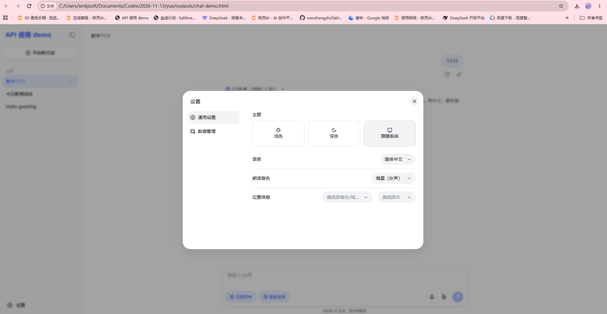
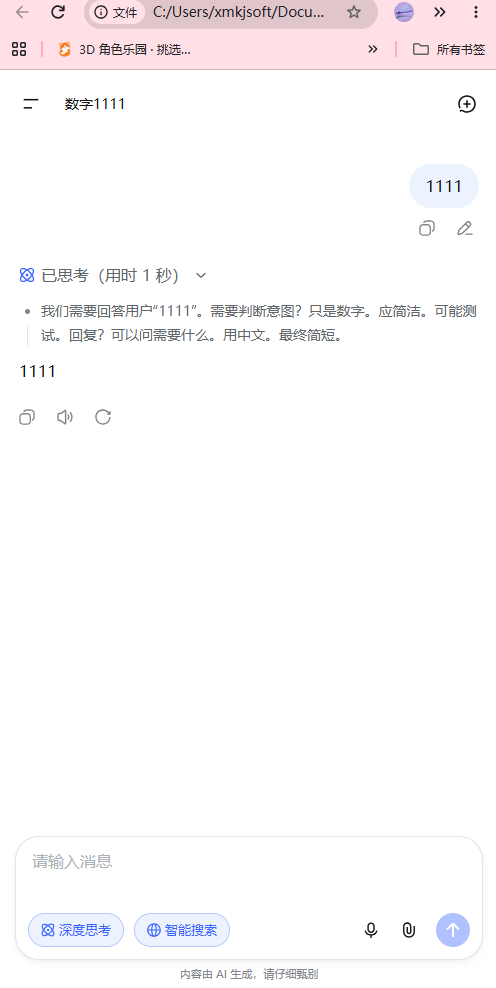
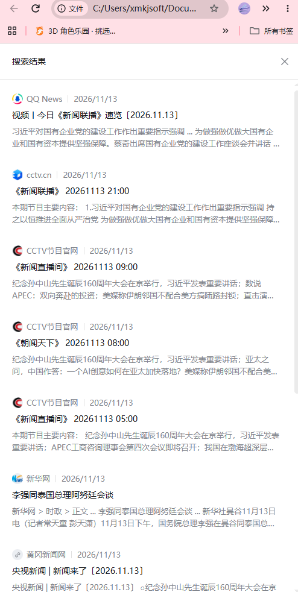
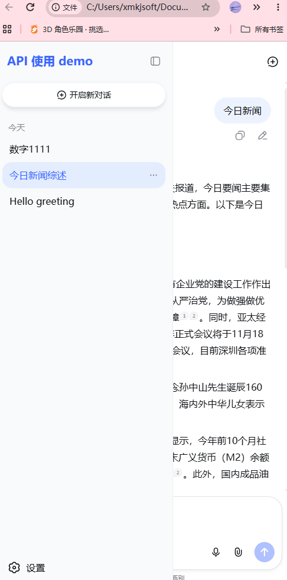

# DeepSeek Chat Demo 单文件版｜下载即开，无需安装

**DeepSeek 最新开源 [`chat-demo`](https://github.com/deepseek-ai/chat-demo) 的单个 HTML 版本。** 不用 Node.js，不用安装依赖，也不用配置构建环境。下载 [`chat-demo.html`](./chat-demo.html)，双击打开，填写自己的 API Key 就能使用。

支持深度思考、智能搜索、流式回答、文件上传、语音输入、回答朗读、Markdown、Mermaid、数学公式和本地聊天历史。

[下载单文件 HTML](https://github.com/wenzhengshi/deepseek-chat-demo-single-file/raw/main/chat-demo.html) · [查看上游源码](https://github.com/deepseek-ai/chat-demo) · [版本说明](./UPSTREAM.md)

> 本项目是非官方单文件构建版。上游基线为 `v0.1.1`，提交 [`5d5dd754ebc1948e977ddb880a9eb5aa25f37b4c`](https://github.com/deepseek-ai/chat-demo/commit/5d5dd754ebc1948e977ddb880a9eb5aa25f37b4c)。DeepSeek 名称和商标归其权利人所有，本仓库不代表官方发布或官方背书。



## 为什么做单文件版

DeepSeek 官方 `chat-demo` 是完整的开源前端工程。对开发者很好，但对只想快速体验、测试 API Key、发给同事或放进资料袋的用户来说，安装 Node.js、拉取依赖和构建项目仍然有门槛。

这个版本把 React 应用、CSS、字体、Mermaid 运行时和其他前端依赖全部内联到一个 HTML 中：

| 使用方式 | 单文件版 | 上游源码版 |
| --- | --- | --- |
| 安装依赖 | 不需要 | 需要 Node.js 和 pnpm |
| 本地构建 | 不需要 | 需要 |
| 使用步骤 | 下载 HTML、双击、填 API Key | 安装、构建、启动服务 |
| 分享给非开发者 | 直接发一个文件 | 需要附带完整工程或构建产物 |
| 修改源码 | 请使用上游仓库 | 适合 |

页面本身不依赖后端服务；聊天、搜索、文件和语音功能仍会由浏览器直接访问 DeepSeek API。你的 API Key 不会上传到本仓库提供的中转服务。

## 开箱即用的功能

- **深度思考**：查看模型的推理过程和耗时。
- **智能搜索**：按需联网搜索、阅读网页并展示引用来源。
- **完整聊天界面**：流式回答、停止生成、继续生成、重新生成和消息分支。
- **文件与语音**：上传附件、图片预览、语音输入和回答朗读。
- **丰富内容渲染**：Markdown、代码高亮、KaTeX 和 Mermaid 图表。
- **本地保存**：会话、设置和附件保存在当前浏览器中。
- **桌面与手机适配**：中英文、明暗主题、响应式布局。

## 快速开始

### 方式一：下载后直接打开

1. [下载 `chat-demo.html`](https://github.com/wenzhengshi/deepseek-chat-demo-single-file/raw/main/chat-demo.html)。
2. 使用较新的 Chrome、Edge 或其他现代浏览器打开。
3. 在设置中填写 API Key，然后开始对话。

部分浏览器会限制 `file://` 页面上的存储、麦克风或跨域请求。若功能异常，请改用静态服务器或 HTTPS 页面。

### 方式二：本地静态服务器

在仓库目录中任选一种方式启动静态服务器：

```sh
npx serve .
```

或：

```sh
python -m http.server 8000
```

随后访问终端提示的本地地址。仓库根目录的 `index.html` 会自动跳转到单文件应用。

## 适合谁

- 想快速测试 DeepSeek API Key，但不想安装开发环境的人。
- 想把体验页面发到群里、课程资料或项目附件中的人。
- 需要在离线环境准备界面、到现场再联网使用的人。
- 想先看 DeepSeek 官方聊天界面效果，再决定是否研究源码的人。

需要注意：单文件版降低了使用门槛，但不适合替代正式生产架构。公开部署时应使用后端代理保护 API Key，并增加访问控制、限流和内容安全策略。

## 界面预览

| 桌面端设置 | 深度思考 |
| --- | --- |
|  |  |

| 搜索结果 | 智能搜索回答 |
| --- | --- |
|  |  |

| 移动端会话列表 | 移动端设置 |
| --- | --- |
|  |  |

<details>
<summary>社区分享截图</summary>


</details>

## 与上游仓库的关系

本项目基于 DeepSeek 官方开源的 [`deepseek-ai/chat-demo`](https://github.com/deepseek-ai/chat-demo) 构建，基线为：

| 项目 | 信息 |
| --- | --- |
| 上游应用版本 | `v0.1.1` |
| 上游提交 | [`5d5dd754ebc1948e977ddb880a9eb5aa25f37b4c`](https://github.com/deepseek-ai/chat-demo/commit/5d5dd754ebc1948e977ddb880a9eb5aa25f37b4c) |
| 上游技术栈 | React 18、TypeScript、Rspack、Zustand |
| 上游许可证 | MIT |
| 本仓库发布形式 | 已构建并内联资源的单 HTML 文件及界面截图 |

本仓库主要用于分享和体验单文件构建结果，不包含上游的可编辑 TypeScript 源码。需要修改功能、重新构建或参与上游开发时，请使用 [DeepSeek 官方仓库](https://github.com/deepseek-ai/chat-demo)。

更详细的构建来源、校验值和许可证说明见 [`UPSTREAM.md`](./UPSTREAM.md)。

## 数据与隐私

- API Key 和界面设置保存在浏览器 `localStorage`。
- 会话、会话摘要和本地附件保存在浏览器 IndexedDB。
- 发送的消息、上传的文件及语音内容会由浏览器直接发送到相应 API 服务。
- API Key 以明文形式保存在当前浏览器配置中，请勿在公共电脑上使用。
- 本项目适合个人演示和技术体验。公开部署时应增加受控的后端代理、访问限制、密钥保护和内容安全策略。

聊天历史的导入会覆盖当前本地对话，界面会在执行前再次确认。导出的 ZIP 包含对话和本地图片，不包含 API Key、设置或原始非图片附件。

## 仓库结构

```text
.
├── chat-demo.html              # 单文件聊天应用
├── index.html                  # 跳转到 chat-demo.html 的静态入口
├── screenshots/                # 桌面端、移动端与分享截图
├── UPSTREAM.md                 # 上游版本与构建来源说明
├── LICENSE                     # 上游 MIT 许可证原文
└── README.md
```

## 使用提示

- 这是前端演示版，浏览器会直接访问 DeepSeek API；能否成功调用取决于网络、CORS、账户余额和 API Key 权限。
- 默认模型、搜索和语音能力由上游实现及对应 API 服务决定。
- 单文件约 5 MB，首次加载需要解析较大的内联脚本和字体。
- 语音功能建议在 `HTTPS` 或 `localhost` 环境中使用。
- 本项目不承诺 API 或页面功能的长期兼容性；上游或 API 变化后可能需要重新构建。

## English

**DeepSeek Chat Demo Single File** is an unofficial, standalone **DeepSeek web UI** and **DeepSeek API demo** packaged as one HTML file. It is intended for anyone looking for a no-install browser chat UI, a single-file LLM frontend, a standalone HTML chatbot, or a quick way to try the DeepSeek API without setting up a build toolchain.

No Node.js installation or build step is required: download `chat-demo.html`, open it in a modern browser, and enter your own DeepSeek API key. It includes streaming chat, deep thinking, smart web search, file upload, voice input, read-aloud, Markdown, syntax highlighting, KaTeX, Mermaid, local conversation history, responsive layouts, and Chinese/English interfaces.

## 许可证与署名

上游项目由 DeepSeek 以 [MIT License](https://github.com/deepseek-ai/chat-demo/blob/main/LICENSE) 发布。本仓库保留完整许可证原文，见 [`LICENSE`](./LICENSE)。

DeepSeek 名称、标识及相关商标归其权利人所有。本项目仅用于说明代码来源，不代表官方关系。

第三方依赖仍受各自许可证约束。

---

如果这个单文件版帮你省下了安装和构建时间，欢迎点一个 **Star**，或把仓库分享给正在体验 DeepSeek 开源 `chat-demo` 的朋友。
