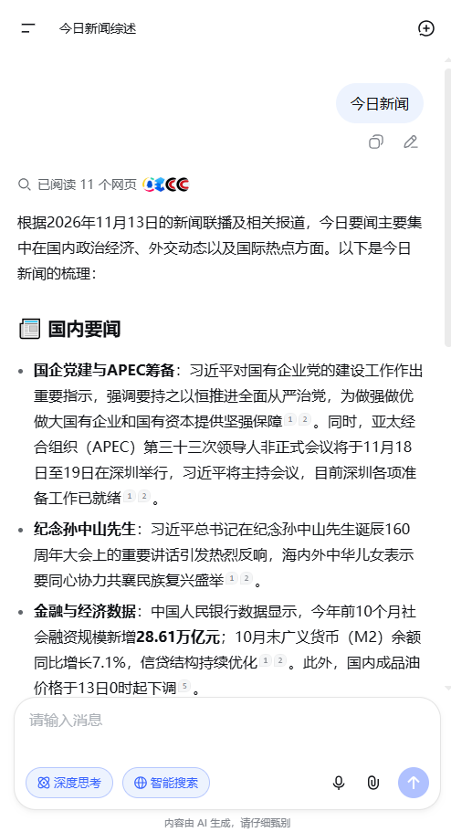
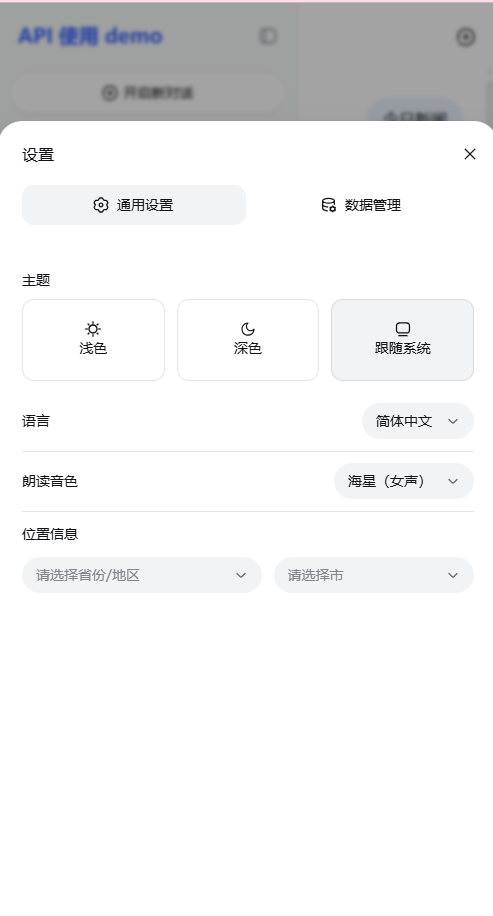
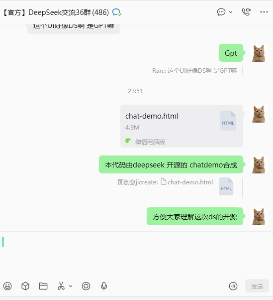

# DeepSeek Chat Demo · 单文件版

> 本项目是 [DeepSeek 开源 `chat-demo`](https://github.com/deepseek-ai/chat-demo) 的非官方单文件构建与展示版。
>
> 上游基线：`v0.1.1`，提交 [`5d5dd754ebc1948e977ddb880a9eb5aa25f37b4c`](https://github.com/deepseek-ai/chat-demo/commit/5d5dd754ebc1948e977ddb880a9eb5aa25f37b4c)。
>
> 本仓库不是 DeepSeek 官方发布物，也不表示 DeepSeek 对本仓库的认可或背书。

[打开聊天页面](./chat-demo.html) · [查看上游源码](https://github.com/deepseek-ai/chat-demo) · [查看基线提交](https://github.com/deepseek-ai/chat-demo/commit/5d5dd754ebc1948e977ddb880a9eb5aa25f37b4c)


## 项目简介

这是一个可直接打开的前端聊天演示。项目把 React 应用、样式、字体、Mermaid 运行时和其他前端依赖内联进一个 `chat-demo.html` 文件，因此界面本身无需安装依赖或启动构建服务。

聊天功能仍然需要联网访问 DeepSeek API，并在页面设置中填写自己的 API Key。API 请求由浏览器直接发出，不经本仓库提供服务端中转。

## 功能

- 多轮对话、自动标题、会话重命名和删除。
- 流式回答、停止生成、继续生成、重新生成。
- 深度思考、智能搜索、网页阅读和引用来源。
- 编辑用户消息，并在消息版本分支之间切换。
- 文件上传、图片预览和拖放上传。
- 语音输入、回答朗读和录音频谱反馈。
- Markdown、代码高亮、KaTeX 数学公式和 Mermaid 图表。
- 简体中文与英文、浅色与深色主题、桌面与移动端布局。
- 本地会话持久化，以及聊天历史的 ZIP 导入与导出。

## 快速开始

### 方式一：直接打开

1. 在 GitHub 中打开 [`chat-demo.html`](./chat-demo.html)，选择下载原始文件。
2. 使用较新的 Chrome、Edge 或其他现代浏览器打开。
3. 在设置中填写 API Key，然后开始对话。

部分浏览器会限制 `file://` 页面上的存储、麦克风或跨域请求。若功能异常，请改用静态服务器或 HTTPS 页面。

### 方式二：本地静态服务器

在仓库目录中任选一种方式启动静态服务器：

```sh
npx serve .
```

或：

```sh
python -m http.server 8000
```

随后访问终端提示的本地地址。仓库根目录的 `index.html` 会自动跳转到单文件应用。

## 界面预览

| 桌面端设置 | 深度思考 |
| --- | --- |
|  |  |

| 搜索结果 | 智能搜索回答 |
| --- | --- |
|  |  |

| 移动端会话列表 | 移动端设置 |
| --- | --- |
|  |  |

<details>
<summary>社区分享截图</summary>



</details>

## 与上游仓库的关系

本项目基于 DeepSeek 官方开源的 [`deepseek-ai/chat-demo`](https://github.com/deepseek-ai/chat-demo) 构建，基线为：

| 项目 | 信息 |
| --- | --- |
| 上游应用版本 | `v0.1.1` |
| 上游提交 | [`5d5dd754ebc1948e977ddb880a9eb5aa25f37b4c`](https://github.com/deepseek-ai/chat-demo/commit/5d5dd754ebc1948e977ddb880a9eb5aa25f37b4c) |
| 上游技术栈 | React 18、TypeScript、Rspack、Zustand |
| 上游许可证 | MIT |
| 本仓库发布形式 | 已构建并内联资源的单 HTML 文件及界面截图 |

本仓库主要用于分享和体验单文件构建结果，不包含上游的可编辑 TypeScript 源码。需要修改功能、重新构建或参与上游开发时，请使用 [DeepSeek 官方仓库](https://github.com/deepseek-ai/chat-demo)。

更详细的构建来源、校验值和许可证说明见 [`UPSTREAM.md`](./UPSTREAM.md)。

## 数据与隐私

- API Key 和界面设置保存在浏览器 `localStorage`。
- 会话、会话摘要和本地附件保存在浏览器 IndexedDB。
- 发送的消息、上传的文件及语音内容会由浏览器直接发送到相应 API 服务。
- API Key 以明文形式保存在当前浏览器配置中，请勿在公共电脑上使用。
- 本项目适合个人演示和技术体验。公开部署时应增加受控的后端代理、访问限制、密钥保护和内容安全策略。

聊天历史的导入会覆盖当前本地对话，界面会在执行前再次确认。导出的 ZIP 包含对话和本地图片，不包含 API Key、设置或原始非图片附件。

## 仓库结构

```text
.
├── chat-demo.html              # 单文件聊天应用
├── index.html                  # 跳转到 chat-demo.html 的静态入口
├── screenshots/                # 桌面端、移动端与分享截图
├── UPSTREAM.md                 # 上游版本与构建来源说明
├── LICENSE                     # 上游 MIT 许可证原文
└── README.md
```

## 使用提示

- 这是前端演示版，浏览器会直接访问 DeepSeek API；能否成功调用取决于网络、CORS、账户余额和 API Key 权限。
- 默认模型、搜索和语音能力由上游实现及对应 API 服务决定。
- 单文件约 5 MB，首次加载需要解析较大的内联脚本和字体。
- 语音功能建议在 `HTTPS` 或 `localhost` 环境中使用。
- 本项目不承诺 API 或页面功能的长期兼容性；上游或 API 变化后可能需要重新构建。

## 许可证与署名

上游项目由 DeepSeek 以 [MIT License](https://github.com/deepseek-ai/chat-demo/blob/main/LICENSE) 发布。本仓库保留完整许可证原文，见 [`LICENSE`](./LICENSE)。

DeepSeek 名称、标识及相关商标归其权利人所有。本项目仅用于说明代码来源，不代表官方关系。

第三方依赖仍受各自许可证约束。
